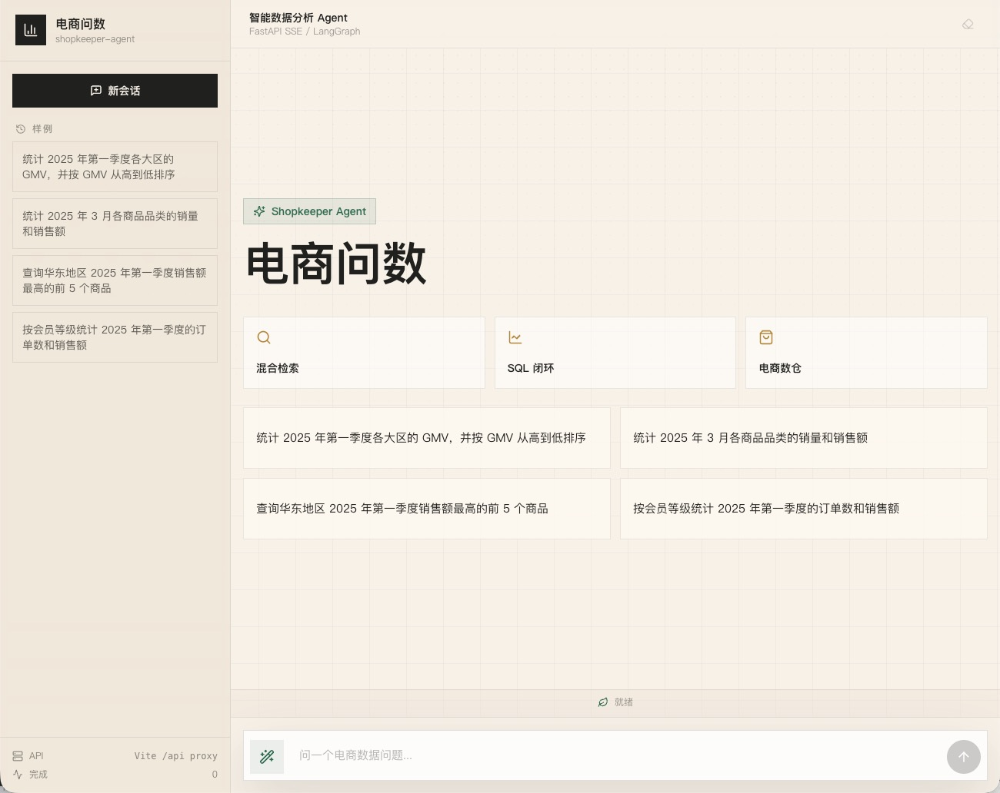
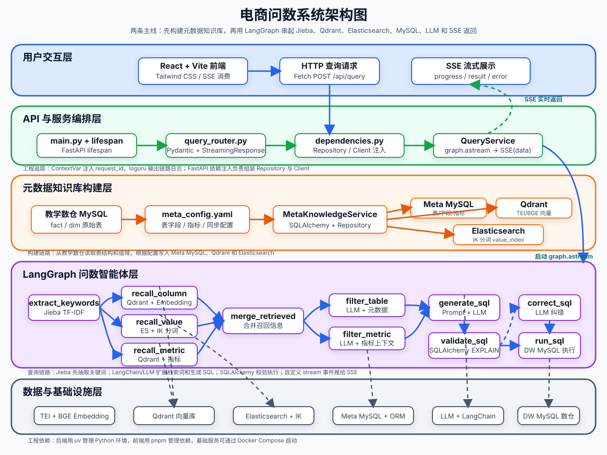
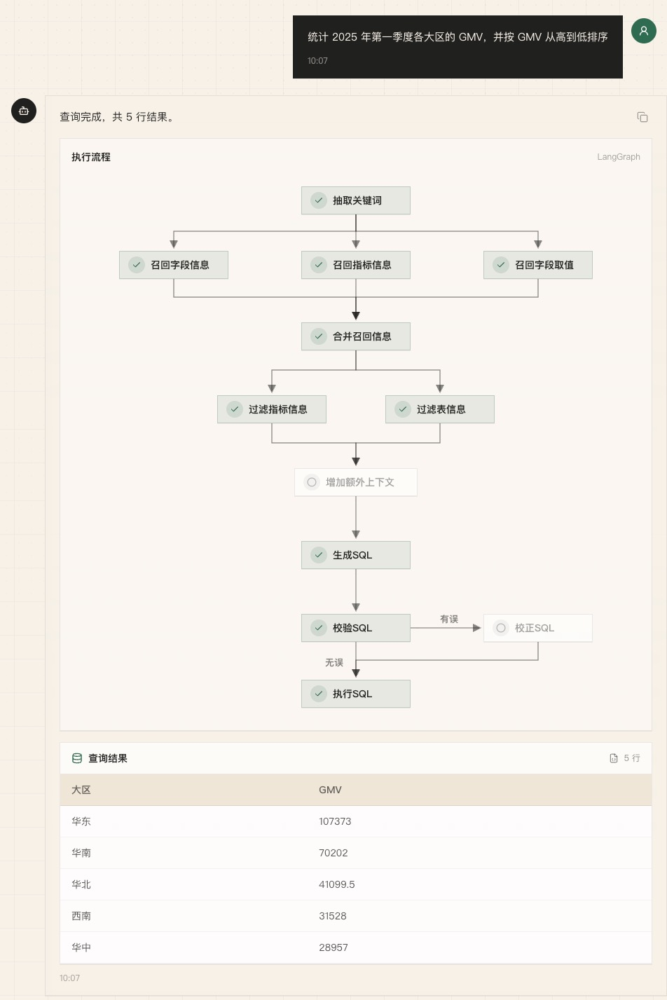

<div align='center'>
  <h1 style="margin-top: 15px;">「电商问数」智能数据分析 Agent</h1>
  <h4><b>shopkeeper-agent</b></h4>
  <p><em>面向电商数仓的自然语言问数系统：元数据知识库 + 混合检索 + 多阶段推理 + SQL 生成执行 + 流式前端展示</em></p>
</div>

<div align='center'>


[项目简介](#introduction) • [核心能力](#features) • [系统架构](#architecture) • [技术栈](#stack) • [快速开始](#quick-start) • [接口说明](#api)

</div>



<a id="introduction"></a>

## 📖 项目简介

在真实的问数场景里，业务同学通常不会写 SQL，数据分析同学也很难随时记住所有表结构、字段含义、指标口径和字段取值。如果把自然语言问题直接丢给大模型，很容易出现表选错、字段选错、指标理解错和 SQL 幻觉。

`shopkeeper-agent` 要解决的就是这条链路：

- 用户用自然语言提问
- 系统自动召回相关字段、指标和字段取值
- 大模型基于检索到的上下文进行分步推理
- 生成 SQL，经过校验与修正后查询数据仓库
- 以 SSE 流式返回推理过程和分析结果

它不是「调一次大模型接口、拼几个 Prompt」的演示，而是一条完整的 AI 应用主线：数据准备 → 检索增强 → 智能体编排 → 接口交付 → 前端联调。

<a id="features"></a>

## ✨ 核心能力

- **检索 + 推理 + 生成，而不是模型直出 SQL**
  - 先围绕问题召回字段、指标和值域，再组织上下文生成 SQL，链路更稳、更可控。
- **面向企业问数场景的混合检索**
  - `Qdrant` 负责字段与指标的语义召回
  - `Elasticsearch` 负责字段取值的全文检索
  - `MySQL` 保存完整、权威的结构化元数据
- **字段、指标、取值三类信息协同召回**
  - 相比单纯的表级或字段级检索，更贴近真实的业务分析流程。
- **从检索到执行的完整可运行链路**
  - 真实生成 SQL、执行查询，并以流式方式返回结果，不止步于 Prompt 设计。
- **查询依据可追溯**
  - 结果之外还会推送本次查询用到的 SQL、召回关键词和命中指标口径，前端可展开查看并一键复制，方便业务方核对「这个数是怎么算出来的」。
- **执行链路耗时可视**
  - 执行流程图按节点展示耗时并汇总总耗时，便于定位链路瓶颈。
- **清晰的工程化后端结构**
  - `FastAPI + LangGraph + Repository + Client Manager`，分层组织配置、客户端、仓储、服务与智能体流程。
- **可扩展的架构基础**
  - 可在此基础上继续叠加权限控制、SQL 审核、结果可视化与评测回归等能力。

<a id="architecture"></a>

## 🏗️ 系统架构



项目围绕两条主线展开：

| 主线             | 做什么                                                                   | 涉及模块                                     |
| ---------------- | ------------------------------------------------------------------------ | -------------------------------------------- |
| 元数据知识库构建 | 抽取数仓中的表、字段、指标和字段取值，写入结构化库、向量库和全文索引     | `MySQL` / `Qdrant` / `Elasticsearch` / `TEI` |
| 自然语言问数     | 基于用户问题完成召回、上下文整理、SQL 生成校验执行，并把过程流式返回前端 | `LangGraph` / `FastAPI` / `SSE` / `React`    |



<a id="stack"></a>

## 🛠️ 技术栈

| 模块       | 技术                              | 作用                                           |
| ---------- | --------------------------------- | ---------------------------------------------- |
| 数仓环境   | `MySQL`                           | 模拟事实表、维度表和分析型查询环境             |
| 元数据库   | `MySQL` / `SQLAlchemy`            | 保存表、字段、指标、字段指标关系等结构化元数据 |
| 向量检索   | `Qdrant`                          | 保存字段和指标向量，支持语义召回               |
| 全文检索   | `Elasticsearch`                   | 保存字段真实取值，支持关键词和值域检索         |
| Embedding  | `TEI` / `BAAI/bge-large-zh-v1.5`  | 将字段、指标、问题等文本转成向量               |
| 智能体编排 | `LangGraph`                       | 组织多阶段问数工作流                           |
| 模型接入   | `LangChain`                       | 封装 LLM 与 Embedding 调用                     |
| 后端接口   | `FastAPI`                         | 提供问数 API、依赖注入和生命周期管理           |
| 流式协议   | `SSE`                             | 实时返回节点进度、查询结果和错误消息           |
| 前端       | `React` / `Vite` / `Tailwind CSS` | 提供聊天式问数界面和流程展示                   |
| 日志追踪   | `ContextVar` / `loguru`           | 为并发请求注入 request_id，便于排查链路        |
| 依赖管理   | `uv` / `pnpm`                     | 管理 Python 后端和前端依赖                     |

## 📁 项目结构

```text
shopkeeper-agent/
├── app/
│   ├── agent/            # LangGraph 图、状态、上下文和各类节点
│   ├── api/              # FastAPI 路由、依赖注入、生命周期和请求结构
│   ├── clients/          # MySQL、Qdrant、Elasticsearch、Embedding 客户端管理
│   ├── conf/             # 配置 dataclass 与配置加载工具
│   ├── core/             # 日志、request_id 上下文等通用能力
│   ├── entities/         # 更贴近业务语义的数据对象
│   ├── models/           # SQLAlchemy ORM 模型
│   ├── prompt/           # Prompt 加载工具
│   ├── repositories/     # MySQL、Qdrant、Elasticsearch 数据访问层
│   ├── scripts/          # 元数据知识库构建脚本
│   └── services/         # 元数据构建服务和问数查询服务
├── conf/                 # app_config.yaml、meta_config.yaml
├── docker/               # Docker Compose、MySQL 初始化 SQL、ES 插件、Embedding 挂载目录
├── frontend/             # React + Vite + Tailwind CSS 前端项目
├── prompts/              # SQL 生成、修正、过滤等 Prompt 模板
├── tests/                # 接口、检索与集成测试
├── main.py               # FastAPI 应用入口
└── pyproject.toml        # Python 项目依赖与工具配置
```

<a id="quick-start"></a>

## 🚀 快速开始

当前仓库已经包含一套可直接启动的本地开发环境，按以下顺序启动即可。

### 1. 准备环境

- Python `>= 3.14`
- `uv`
- Docker 与 Docker Compose
- Node.js 与 `pnpm`

### 2. 克隆项目

```bash
git clone https://github.com/ranyan666/shopkeeper-agent.git
cd shopkeeper-agent
```

### 3. 安装后端依赖

```bash
uv sync
```

### 4. 配置大模型 API Key

```bash
cp .env.example .env
```

把 `.env` 中的 `LLM_API_KEY` 替换成真实密钥：

```bash
LLM_API_KEY=your_real_api_key
```

默认配置使用兼容 OpenAI 接口的硅基流动服务：

```yaml
llm:
    model_name: Pro/zai-org/GLM-5.1
    api_key: ${oc.env:LLM_API_KEY}
    base_url: https://api.siliconflow.cn/v1
```

如需使用其他兼容 OpenAI API 的模型平台，修改 [conf/app_config.yaml](conf/app_config.yaml) 中的 `model_name` 和 `base_url`。

### 5. 准备 Embedding 模型

项目通过 `TEI` 加载 `BAAI/bge-large-zh-v1.5`。模型文件体积较大，无法在仓库中提交，需要先下载到 Docker 挂载目录：

```bash
uv run hf download BAAI/bge-large-zh-v1.5 --local-dir docker/embedding/bge-large-zh-v1.5
```

如果手动下载，请解压到 `docker/embedding/bge-large-zh-v1.5` 路径下。

### 6. 启动 Docker 基础服务

```bash
docker compose -f docker/docker-compose.yaml up -d
```

默认端口：

| 服务          | 端口   |
| ------------- | ------ |
| MySQL         | `3306` |
| Elasticsearch | `9200` |
| Kibana        | `5601` |
| Qdrant        | `6333` |
| Embedding     | `8081` |

> `docker/mysql/meta.sql` 和 `docker/mysql/dw.sql` 会在 MySQL 容器首次启动时自动初始化元数据库和数仓。

### 7. 构建元数据知识库

```bash
uv run python -m app.scripts.build_meta_knowledge -c conf/meta_config.yaml
```

这一步会把表字段元数据写入 MySQL，把字段和指标向量写入 Qdrant，并把字段真实取值写入 Elasticsearch。

### 8. 启动后端

```bash
uv run fastapi dev main.py
```

### 9. 启动前端

```bash
cd frontend
pnpm install
pnpm dev
```

前端默认通过 Vite 代理把 `/api` 转发到 `http://127.0.0.1:8000`。如需修改：

```bash
cd frontend
cp .env.example .env
```

```bash
VITE_DEV_PROXY_TARGET=http://127.0.0.1:8000
```

<a id="api"></a>

## 🔌 接口说明

```text
POST http://127.0.0.1:8000/api/query
```

请求示例：

```json
{
    "query": "统计华北地区的销售总额"
}
```

SSE 消息类型：

| 类型       | 含义                                       |
| ---------- | ------------------------------------------ |
| `progress` | 节点执行进度                               |
| `meta`     | 查询依据：SQL、召回关键词与命中指标口径    |
| `result`   | 最终查询结果                               |
| `error`    | 全局异常消息                               |

`meta` 事件固定发生在 `result` 之前，前端据此把「查询依据」和结果一起渲染：

```json
{
    "type": "meta",
    "sql": "SELECT SUM(o.amount) FROM dw.dwd_order o WHERE o.region = '华北'",
    "keywords": ["华北", "销售额"],
    "metrics": [{ "name": "GMV", "description": "成交总额", "alias": ["成交额"] }]
}
```

## ✅ 测试

### 后端

```bash
uv run python -m unittest discover -s tests -p "test_*.py"
```

- `test_api_contract.py` / `test_query_service.py` / `test_query_meta.py` 是纯单元测试，不依赖任何外部服务。
- `test_query_meta.py` 覆盖 SQL 展示格式、关键词与口径整理、`run_sql` 发送 `meta` 事件，以及 `meta` 穿透 HTTP 的 SSE 契约。
- `test_environment.py` / `test_metadata.py` / `test_retrieval.py` 属于集成测试，需要先启动 Docker 基础服务并完成元数据知识库构建。
- `tests/e2e_smoke.py` 是端到端冒烟脚本，需先启动后端后单独运行。

### 前端

```bash
cd frontend
pnpm test      # node:test，覆盖 SSE 事件解析与节点耗时计算
pnpm lint      # tsc 类型检查
pnpm build     # 生产构建
```

<a id="boundaries"></a>

## 🚧 能力边界

本项目聚焦智能问数的核心链路，暂不覆盖生产治理能力，例如：

- 用户登录、角色权限和数据权限控制
- 多租户隔离
- SQL 安全审计和执行白名单
- 查询缓存、限流和性能治理
- 系统化评测集与自动化回归
- 监控告警、链路追踪平台和灰度发布
- 多轮问数记忆、追问改写和会话管理

这些能力适合在基础链路跑通之后继续扩展。

## 🗺️ Roadmap

- [ ] 多轮对话与追问改写
- [ ] SQL 审核与执行白名单
- [ ] 查询结果可视化图表
- [ ] 问数评测集与自动化回归

## 🙏 致谢

本项目的选题与初版实现源自 [didilili/shopkeeper-agent](https://github.com/didilili/shopkeeper-agent)（MIT License），其原始版本基于尚硅谷「大模型智能体掌柜问数」课程整理。本仓库在此基础上持续完善与演进，并保留原始版权声明。

## 📄 License

[MIT](LICENSE)
